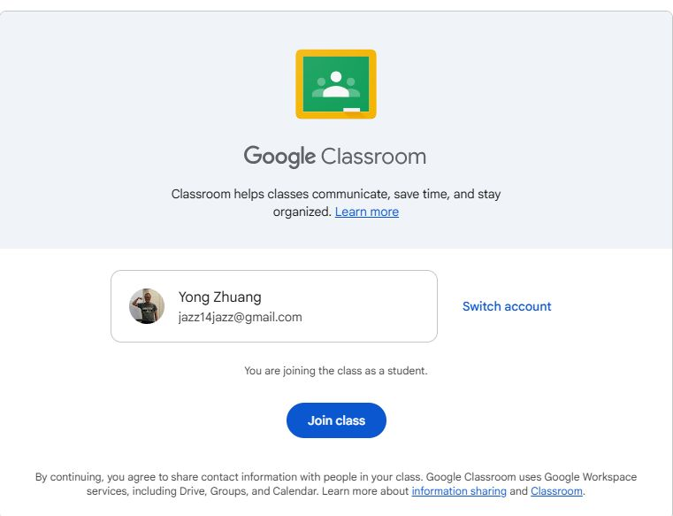
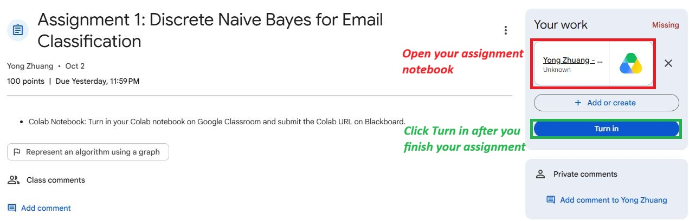
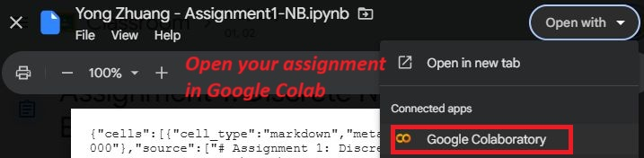

# How to Access and Submit the Assignment

Please follow the steps below to access the assignment notebook, complete it in Google Colab, and turn it in.

## Step 1: Join the Google Classroom

Click the Google Classroom invitation link provided for this course.

You should see a page similar to the screenshot below.

1. Make sure you are signed in with the Google account you want to use for this assignment.
2. Click **Join class**.
3. After joining, you will be able to access the assignment in Google Classroom.

---

## Step 2: Open the Assignment

Open the assignment in Google Classroom.

You should see a page similar to this:

Under **Your work**, you should see your assigned notebook.

1. Click the notebook file under **Your work**.
2. This notebook is your own copy of the assignment.
3. Do **not** remove the notebook from the assignment.

---

## Step 3: Open the Notebook in Google Colab

After clicking the notebook, it may first open in a Google Drive preview window.

Click **Open with** and select **Google Colaboratory**.

The notebook will then open in Google Colab.

Complete all required tasks directly in this notebook.

> **Important:** Make sure your work is saved before submitting. Google Colab normally saves changes automatically to Google Drive, but you should verify that your latest work has been saved.

---

## Step 4: Turn In the Assignment

After you finish the assignment:

1. Return to the assignment page in **Google Classroom**.
2. Make sure your completed notebook still appears under **Your work**.
3. Click **Turn in**.
4. Confirm the submission if Google Classroom asks you to confirm.

Your assignment is not considered submitted until you click **Turn in**.

---

## Step 5: Submit the Colab URL on Blackboard

After turning in the notebook on Google Classroom:

1. Open your completed notebook in Google Colab.
2. Copy the notebook URL from your browser.
3. Submit the **Google Colab notebook URL** on Blackboard as required.

Please make sure you complete **both** submission steps:

- **Turn in the notebook on Google Classroom**
- **Submit the Colab URL on Blackboard**